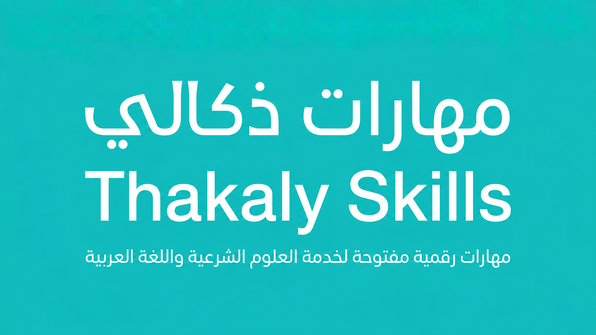

# مهارات ذكالي | Thakaly Skills

**أدوات ومهارات رقمية لخدمة العلوم الشرعية واللغة العربية**

يضم المستودع أدوات لمراجعة النصوص والمستندات وتنظيم البيانات العلمية، ومهارات إرشادية للباحثين، وروابط إلى مشروعات خارجية نافعة.

## تصفح المهارات

| القسم | ماذا يقدم؟ |
|---|---|
| **[مهارات الدكتور سعود العقيل — أدوات لخدمة الباحث العربي](collections/saud-al-aqeel/README.md)** | فحص النص العربي والحواشي والفهارس والشواهد |
| **[الدراسات السابقة والمراجع](#الدراسات-السابقة-والمراجع)** | تنظيم الدراسات وفحص بياناتها والتكرار المحتمل |
| **[التحرير والبحث العلمي](#التحرير-والبحث-العلمي)** | إرشادات تحرير النصوص وتوثيقها وتقويم الخطط |
| **[أدوات علمية وتقنية إضافية](#أدوات-علمية-وتقنية-إضافية)** | أدوات ومشروعات مساندة |
| **[دليل الأدوات الخارجية](directory/README.md)** | التعرف على خدمات مستقلة والوصول إلى مواقعها الأصلية |

## مهارات الدكتور سعود العقيل

**[أدوات لخدمة الباحث العربي](collections/saud-al-aqeel/README.md)**

مهارات في تحرير النصوص العربية وتدقيق الحواشي والفهارس والاقتباسات، مع **ثلاث أدوات جديدة لمستندات Word**: [جرد الإشارات المرجعية](skills/docx-bookmark-inventory/)، [استخراج تعليقات المراجعين](skills/docx-review-comments-extractor/)، و[جمع المقاطع المظللة](skills/docx-highlight-extractor/).

## الدراسات السابقة والمراجع

- [خريطة الدراسات السابقة](skills/literature-map/) — تنظيم الدراسات بحسب الموضوع والمنهج والسنة.
- [مستخرج بيانات الدراسات](skills/study-extractor/) — فحص اكتمال بيانات الدراسات.
- [فاحص الفجوات البحثية](skills/gap-auditor/) — بيان المجالات غير الممثلة في مجموعة الدراسات المقدمة.
- [مراجع البيانات الببليوغرافية](skills/reference-auditor/) — كشف النواقص والتكرارات المحتملة.

## التحرير والبحث العلمي

- [سلامة النص العربي](skills/arabic-text-integrity/)
- [تدقيق الاقتباسات الشرعية](skills/quran-hadith-quote-auditor/)
- [حفظ الحواشي والإحالات](skills/academic-footnote-preserver/)
- [تحكيم الخطط البحثية](skills/islamic-studies-research-plan-review/)
- [مراجعة سلسلة النسبة](skills/scholarly-attribution-chain-review/)
- [مقارنة الطبعات](skills/manuscript-edition-comparison/)
- [كشف تشابه العناوين](skills/research-title-duplicate-screening/)
- [جودة البيانات العربية](skills/arabic-research-data-quality/)

## أدوات علمية وتقنية إضافية

- [مدقق المصدر والنسبة](skills/thakaly-source-attribution-auditor/)
- [رقمنة الكتب والكشافات](skills/marqoom-book-digitization/)
- [تحرير الكتب العربية](skills/arabic-book-editing/)
- [إعداد دفعات العناوين](skills/thakaly-titles-batch-builder/)
- [تنظيم الأفكار البحثية](skills/thakaly-ideas-batch/)
- [البحث في النصوص التراثية](skills/turath-research-helper/)
- [تدقيق جداول البيانات العلمية](skills/scientific-excel-auditor/)
- [تهيئة خوادم البحث المساعدة](skills/remote-mcp-production/)

## دليل الأدوات الخارجية

[تصفح الدليل](directory/README.md) للوصول إلى مشروعات وخدمات نافعة باللغة العربية، مع التعريف بوظيفة كل أداة ورابطها الأصلي.

## كيف تستخدم المهارات؟

اختر المهارة، ثم اقرأ ملف `SKILL.md` الخاص بها لتعرف وظيفة الأداة ومدخلاتها وخطوات استخدامها. تختلف المهارات بين برامج قابلة للتشغيل وإرشادات قابلة للتطبيق وبطاقات تعريفية لمشروعات قيد التطوير؛ ويبيّن كل مدخل ما يقدمه.

## أضف مهارة أو اطرح سؤالًا

- **لديك فكرة لمهارة أو سؤال عن الاستخدام؟** [أرسل اقتراحًا أو سؤالًا عبر Issues](../../issues/new/choose)، واذكر ما تحتاج إليه بإيجاز.
- **لديك مهارة جاهزة أو تحسين برمجي؟** [قدّم مساهمتك عبر Pull Requests](../../pulls)، وراجع [دليل المساهمة](CONTRIBUTING.md) لمعرفة الملفات المطلوبة.
- **وجدت مشكلة؟** [بلّغ عنها هنا](../../issues/new/choose) مع مثال يوضحها، دون مشاركة بيانات خاصة.

تُراجع المساهمات قبل إضافتها إلى المستودع.

## الترخيص

تخضع ملفات المشروع التي يملك حقوقها لترخيص [MIT](LICENSE)، وتبقى حقوق الأدوات والمواد الخارجية لأصحابها.
